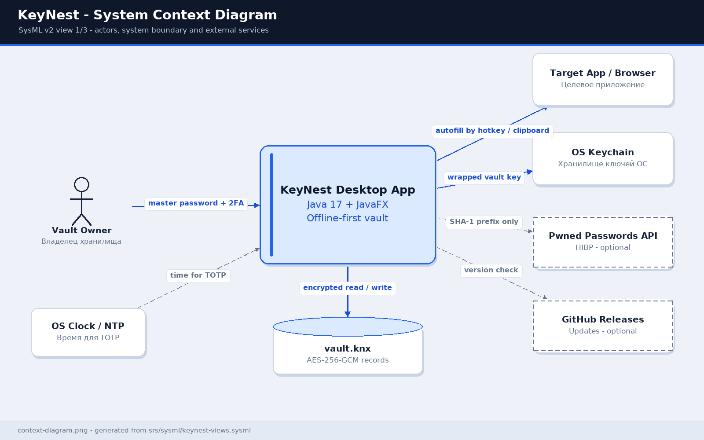
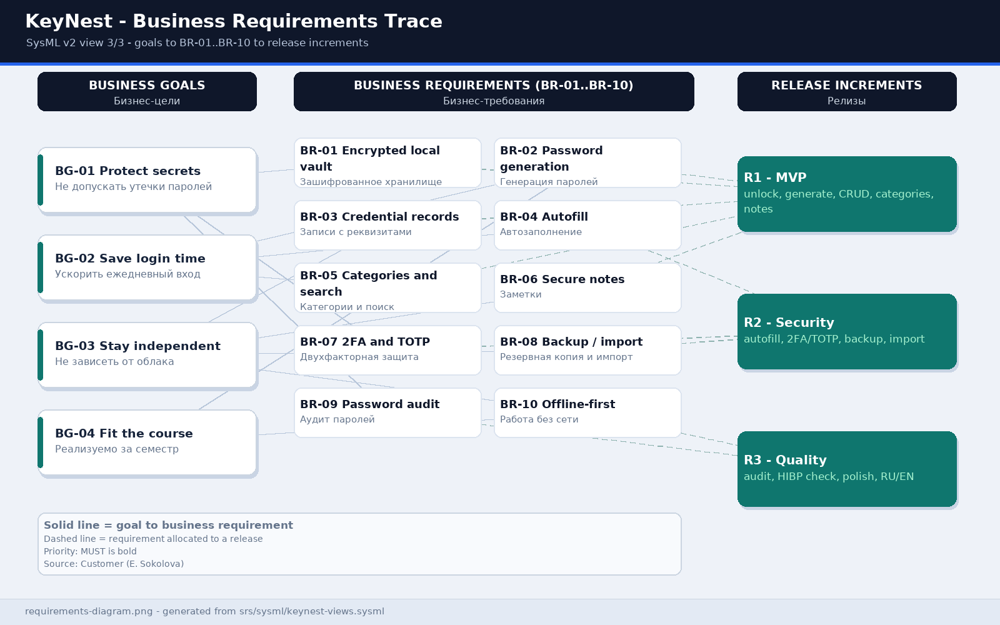

# KeyNest Business Requirements

**Password manager — course project for "Software Life Cycle Requirements Engineering" (ZhTsRPO), lab work #3**

| Field | Value |
|-------|-------|
| Version | 0.1 |
| Date | 2026-10-25 |
| Prepared by | repository owner (analyst/developer) + team mate assigned by the instructor |
| Customer | Elena Sokolova, office manager of "Byte" (12 employees) — training persona |
| Status | agreed with the Customer (training case); team mate name and dates pending confirmation |
| Languages | English (this file) and Russian ([business-requirements.md](business-requirements.md)) |

> All people except the repository owner are fictional training personas. The team mate's name, group and calendar dates are filled in after the instructor's assignment.

---

## 1. Application and project type choice (task 1)

| Parameter | Decision for the course project |
|-----------|---------------------------------|
| **Project name** | **KeyNest** ("КейНест") — "a nest for your keys" |
| **Domain** | Password manager: password generation and storage, autofill, categories, notes, two-factor authentication |
| **Project type** | **Desktop application**, offline-first, one user — one device — one vault |
| **External services** | **Disabled by default**; optional: (1) HIBP Pwned Passwords API — breach check with k-anonymity (only 5 SHA-1 characters are sent), (2) GitHub Releases — update notification only. Local OS "services": keychain, system clock, clipboard |
| **Preferred technologies** | Java 17 LTS, JavaFX 21 (GUI), Maven, SQLite / local `vault.knx` file, AES-256-GCM, Argon2id, RFC 6238 (TOTP), Jackson, SLF4J, JUnit 5, jpackage |
| **Development language** | **Java 17** (primary), SQL/JSON for data, Markdown + SysML v2 for documentation and models |
| **Description language** | Russian and English (SRS/BRD), SysML v2 textual notation for models and GUI mock-ups; application UI RU/EN |
| **Product boundaries** | One local encrypted file, up to 1000 records; no cloud sync, no server, no mobile clients or browser extensions in v0.1; Windows 10/11 and Linux x86_64 (macOS — R3+) |
| **Budget and schedule** | 0 BYN, open-source libraries only; one 2026/2027 semester, three increments R1/R2/R3 |
| **Licence** | MIT for project code, `NOTICE.md` for dependencies |

**Rationale.** The Customer needs a simple but genuinely useful product: passwords are currently kept in a text file and on sticky notes, reused across sites, and logging into 20+ services takes time. A password manager delivers measurable value (security + speed) and is feasible within one semester. Java was chosen because the student plans to write code in Java; JavaFX provides a cross-platform desktop GUI without a web stack. Avoiding the cloud simplifies security and removes infrastructure dependency — captured as business requirement BR-10.

Solution context (SysML v2 → PNG): [img/context-diagram.png](img/context-diagram.png).

## 2. Project participants (task 2)

| Role | Who | Responsibilities |
|------|-----|------------------|
| Customer | Elena Sokolova, office manager of "Byte" (training persona) | States business needs, accepts releases, checks usability |
| Team mate | Artem Kovalev, a student assigned by the instructor (training name) | Co-authors the SysML v2 model, reviews requirements, QA and acceptance tests |
| Analyst / developer | repository owner `dzmitry-murauyou` | Customer interview, SRS, Java implementation, build |
| Security reviewer | instructor / invited reviewer | Checks cryptography and absence of secrets in logs |
| Instructor | course "ZhTsRPO" | Assigns the team mate, approves the option and the schedule |

**Customer interview (story).** "I have 12 employees and about 30 services: email, bank, GitHub, CRM, hosting. Passwords are written in a file on the desktop, half of them are the same. I want one tool that invents strong passwords, fills them in, organises them into folders and shows 2FA codes. I do not trust the cloud — everything must stay on my computer. It is important that I do not lose access if I wipe the phone with the 2FA code."

## 3. Business goals

| ID | Goal | Success metric |
|----|------|----------------|
| BG-01 | Prevent password leakage and reuse | 0 clear-text passwords on disk; reused-password share in the audit < 10 % by R3 |
| BG-02 | Speed up daily logins | record search ≤ 200 ms, autofill ≤ 2 s; login time drops from ~40 s to ~10 s |
| BG-03 | Stay independent of clouds and vendors | all core functions work offline; migration is one encrypted file |
| BG-04 | Fit the course project | three increments in one semester, budget 0 BYN, 100 % requirements traceability |

## 4. Customer business requirements (BR-01…BR-10)

Priorities: **MUST** — mandatory, **SHOULD** — desirable, **COULD** — deferrable. Traceability to SRS requirements — [srs-template-en.md](srs-template-en.md), Section 3 and Appendix B.

| ID | Requirement | Statement (Customer's voice) | Rationale | Priority | Acceptance criterion | Release | Trace |
|----|-------------|------------------------------|-----------|----------|----------------------|---------|-------|
| BR-01 | Local encrypted vault | "I want to open all passwords with one master password, and the file must be unreadable without it" | BG-01 | MUST | records are unreadable without the password; 5 wrong attempts → 30 s delay | R1 | REQ-FUNC-001, REQ-SEC-001…004 |
| BR-02 | Password generation | "Let the program invent strong passwords while I choose the length and characters" | BG-01, BG-02 | MUST | length 8–64, 4 character classes, entropy estimate | R1 | REQ-FUNC-003 |
| BR-03 | Credential records | "Every service needs a card: login, password, site, folder, note" | BG-02 | MUST | CRUD works for 1000 records | R1 | REQ-FUNC-004 |
| BR-04 | Autofill | "So I do not copy passwords by hand, let it insert them with a hotkey" | BG-02 | MUST | `Ctrl+Shift+K` → overlay within 2 s, clipboard cleared after 30 s | R2 | REQ-FUNC-008 |
| BR-05 | Categories and search | "I want folders 'Work', 'Finance' and fast search by title/login" | BG-02 | MUST | search ≤ 200 ms for 1000 records | R1 | REQ-FUNC-005, REQ-FUNC-006 |
| BR-06 | Secure notes | "I need hints and recovery codes next to the password" | BG-02 | SHOULD | up to 2000 characters, encrypted like the password | R1 | REQ-FUNC-007 |
| BR-07 | Two-factor authentication | "I need 2FA codes for websites and a second factor for the vault itself" | BG-01 | MUST | TOTP 6 digits / 30 s, recovery key | R2 | REQ-FUNC-002, REQ-FUNC-009 |
| BR-08 | Backup and portability | "If the laptop breaks I must restore the passwords and move them to another PC" | BG-03 | MUST | encrypted export / CSV import, lossless restore | R2 | REQ-FUNC-010, REQ-FUNC-011 |
| BR-09 | Password audit | "Show me where passwords are weak or reused" | BG-01 | SHOULD | report on weak/reused/old passwords, HIBP only with consent | R3 | REQ-FUNC-012 |
| BR-10 | Offline-first and privacy | "Everything must work without the Internet and without a cloud account" | BG-03 | MUST | offline mode covers R1 and R2; no telemetry by default | R3 | REQ-AVAIL-001 |

Trace diagram "goals → requirements → releases" (SysML v2): [img/requirements-diagram.png](img/requirements-diagram.png).

## 5. Business rules

| ID | Rule |
|----|------|
| BR-RULE-01 | Master password ≥ 12 characters; never stored on disk |
| BR-RULE-02 | Recovery key — 24 characters, one-time, shown once at vault creation |
| BR-RULE-03 | Auto-lock after 5 minutes of inactivity, on minimisation and on OS screen lock |
| BR-RULE-04 | A copied password is removed from the clipboard after 30 s |
| BR-RULE-05 | 5 failed attempts → 30 s delay; the reason for failure is not disclosed |
| BR-RULE-06 | Categories have one nesting level; deleting a category does not delete records |
| BR-RULE-07 | One TOTP secret per record; time comes from the system clock |
| BR-RULE-08 | Export/import require re-entering the master password |
| BR-RULE-09 | Network features (HIBP, update check) are enabled only with explicit consent |
| BR-RULE-10 | Note ≤ 2000 characters; the audit log contains no secrets |

## 6. Project boundaries

**In scope:** unlock/2FA, generation, record CRUD, categories, search, favourites, notes, autofill, TOTP, backup/restore, CSV import, encrypted JSON export, password audit, RU/EN UI, local audit log, Windows/Linux installers.

**Out of scope for v0.1:** cloud sync and accounts, team sharing and password transfer, mobile apps, browser extension, biometrics and FIDO2, payment-card storage, AI/ML, macOS in R1, external SIEM and paid support.

Use case diagram: [img/use-case-diagram.png](img/use-case-diagram.png).

## 7. Course project success criteria

1. All 10 business requirements are traced to REQ IDs and verification methods (100 %).
2. A new user creates a vault, generates a password and finds a record within 60 s without instructions.
3. `vault.knx` and logs contain no clear-text passwords or TOTP secrets (reviewer check).
4. All R1/R2 scenarios work with the network disconnected.
5. The SRS is filled in Russian and English; the graphical part is exported to PNG from the SysML v2 model.

## 8. Risks and assumptions

| Risk | Likelihood | Mitigation |
|------|------------|------------|
| Master password loss | medium | mandatory recovery key and warning at creation (BR-RULE-02) |
| Global hotkey conflict | medium | configurable combination and clipboard fallback (assumption A-06) |
| System clock drift | low | warning and ±1 TOTP step tolerance |
| HIBP/GitHub unavailability | high | features are optional; local audit works offline |
| JavaFX/Java 17 incompatibility | low | PoC-1 before R1 |

Full assumption register — [srs-template-en.md](srs-template-en.md), Section 2.5.

## 9. Graphical artefacts (SysML v2 → PNG)

| File | Shows |
|------|-------|
| [img/context-diagram.png](img/context-diagram.png) | system boundaries, actors and external services |
| [img/use-case-diagram.png](img/use-case-diagram.png) | use cases UC-01…UC-10 |
| [img/requirements-diagram.png](img/requirements-diagram.png) | goals → BR-01…BR-10 → releases R1/R2/R3 |
| [img/gui-unlock.png](img/gui-unlock.png) | unlock / 2FA screen mock-up |
| [img/gui-vault.png](img/gui-vault.png) | vault mock-up: categories, search, record, TOTP |
| [img/gui-record-editor.png](img/gui-record-editor.png) | record, notes and generator mock-up |
| [img/gui-autofill.png](img/gui-autofill.png) | autofill mock-up |

Model sources: [sysml/keynest-model.sysml](sysml/keynest-model.sysml), [sysml/keynest-views.sysml](sysml/keynest-views.sysml). Renderer: [tools/render_sysml.py](tools/render_sysml.py). Rebuild instructions — [README.md](README.md).

## 10. Revision history

| Name | Date | Reason For Changes | Version |
|------|------|--------------------|---------|
| KeyNest team | 2026-10-25 | Initial project option, participants and business requirements BR-01…BR-10 | 0.1 |
