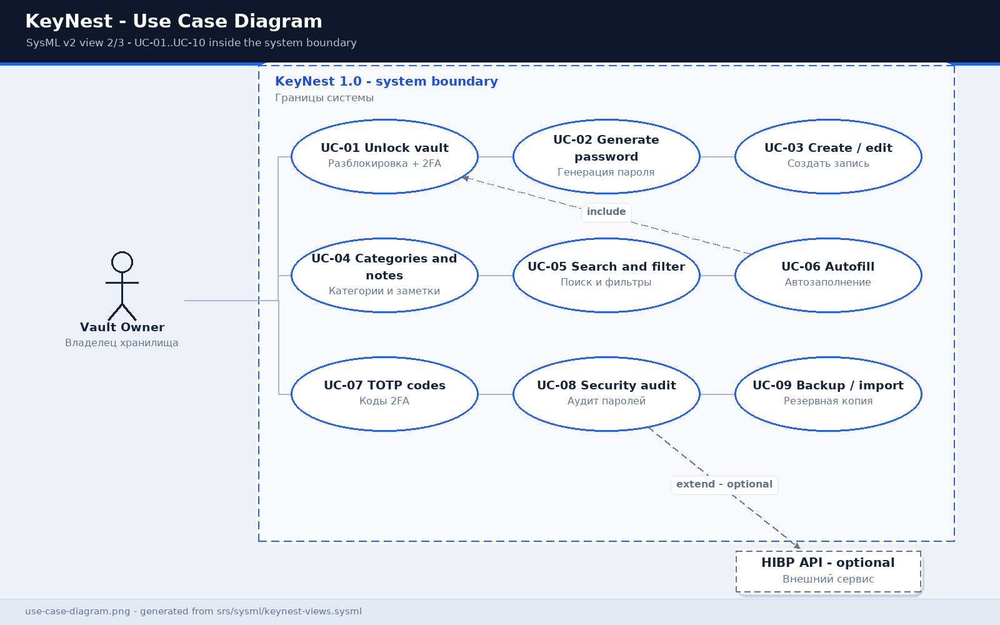
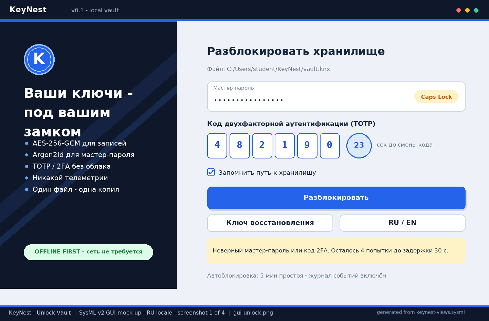
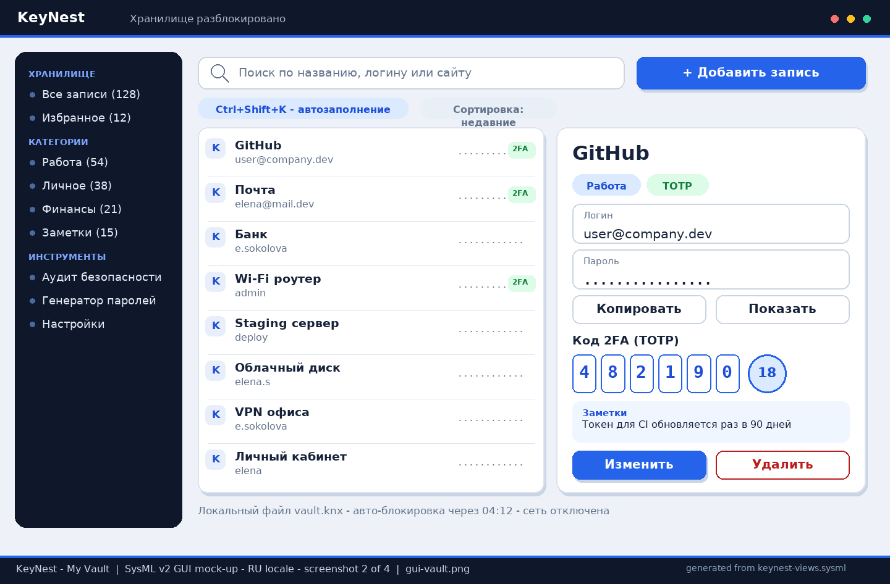
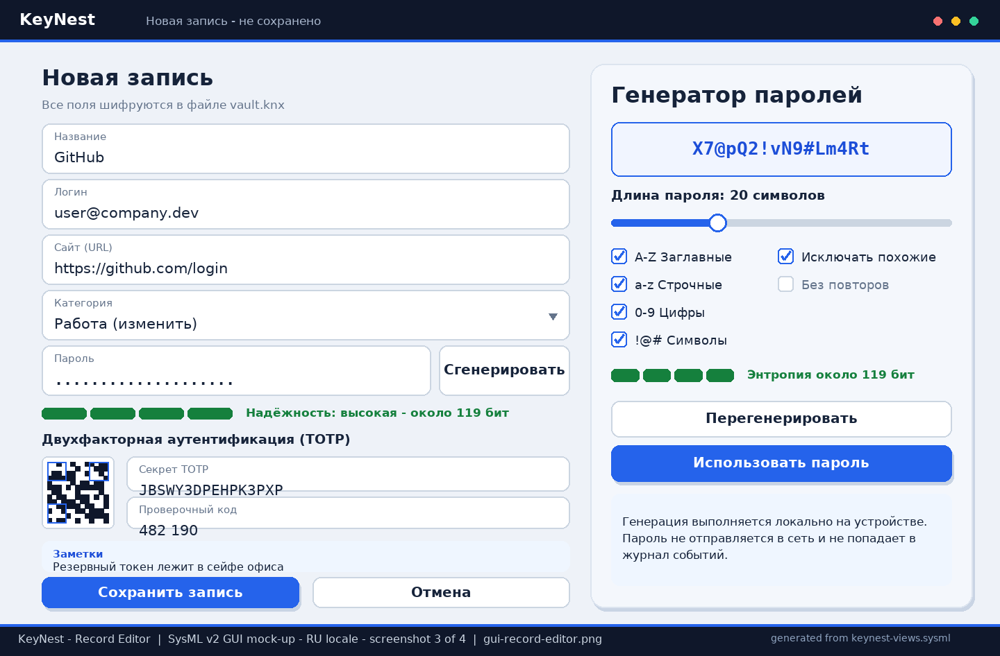
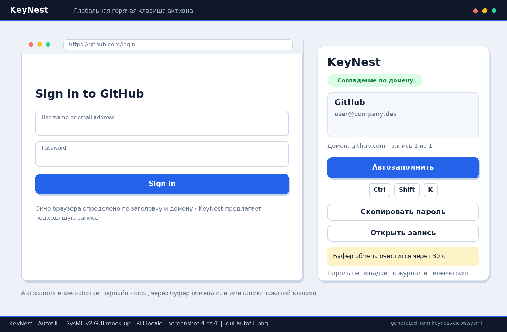

# Software Requirements Specification

## For KeyNest — Password Manager

**Version:** 0.1 (Customer business requirements, lab work #3)  
**Prepared by:** the KeyNest project team — repository owner (analyst/developer) and the team mate assigned by the instructor  
**Organisation:** BSUIR, course "Software Life Cycle Requirements Engineering" (ZhTsRPO), course project  
**Date modified:** 2026-10-25  
**Document language:** English (Russian version — [srs-template.md](srs-template.md))

> This document follows `srs/srs-template-en.md` from the lab #2 repository (`SDLC`). Customer business requirements, stakeholder roles and the project choice are documented in [business-requirements-en.md](business-requirements-en.md). The graphical part is modelled in **SysML v2** and exported to PNG in [srs/img](img/).

## Table of Contents

1. [Introduction](#1-introduction) — 1.1 Purpose · 1.2 Scope · 1.3 Definitions · 1.4 References · 1.5 Overview
2. [Product Overview](#2-product-overview) — 2.1 Perspective · 2.2 Functions · 2.3 Constraints · 2.4 Users · 2.5 Assumptions · 2.6 Apportioning
3. [Requirements](#3-requirements) — 3.1 Interfaces · 3.2 Functional · 3.3 QoS · 3.4 Compliance · 3.5 Design & Implementation · 3.6 AI/ML
4. [Verification](#4-verification)
5. [Appendixes](#5-appendixes)

## Revision History

| Name | Date | Reason For Changes | Version |
|------|------|--------------------|---------|
| KeyNest team | 2026-10-25 | Initial version: project choice, BR-01…BR-10, SysML v2 diagrams and GUI mock-ups | 0.1 |

---

## 1. Introduction

### 1.1 Document Purpose

This SRS defines **what** KeyNest shall do, not how it will be implemented. It is used by the product team (Customer and team mate), Java developers, QA, the security reviewer and the instructor throughout the course project: to agree scope, drive design, write tests and accept releases R1–R3. It is derived from the business requirements in [business-requirements-en.md](business-requirements-en.md) and from the lab #2 template. Related artefacts: [sysml/keynest-model.sysml](sysml/keynest-model.sysml) and [sysml/keynest-views.sysml](sysml/keynest-views.sysml). Every requirement has an immutable ID `REQ-[AREA]-[NNN]` and is verified as described in Section 4.

### 1.2 Product Scope

**KeyNest v0.1** is a new **desktop password manager** for one user and one device. It generates strong passwords, stores credentials in a single locally encrypted `vault.knx` file, organises records into categories, keeps secure notes, autofills logins and passwords, and supports two-factor authentication (TOTP). The business objective is to stop keeping passwords in text files and sticky notes, to speed up daily logins and to stay independent of cloud services.

**In scope:** master-password/2FA unlock; password generation; record CRUD; categories, search, favourites; secure notes; hotkey autofill; TOTP codes; backup, restore, import/export; weak/reused-password audit; Russian and English UI; offline operation.

**Out of scope (deferred):** cloud sync and accounts, mobile apps, a browser extension, team sharing, biometrics and hardware keys, payment-card storage, AI/ML features, macOS support in R1 (see [2.6](#26-apportioning-of-requirements)).

The system context and its boundaries are shown in [img/context-diagram.png](img/context-diagram.png):

### 1.3 Definitions, Acronyms, and Abbreviations

| Term | Definition |
|------|------------|
| 2FA | Two-factor authentication; in KeyNest — master password + TOTP code, or a recovery key |
| AES-256-GCM | Authenticated encryption mode applied to vault records |
| Argon2id | Password-based key derivation function resistant to GPU brute force |
| BR | Business Requirement from the Customer (`BR-01`…`BR-10`) |
| HIBP | Have I Been Pwned / Pwned Passwords — optional external breach-check service (k-anonymity) |
| KDF | Key Derivation Function producing the encryption key from the master password |
| MVP | Minimum viable product; equals release R1 in this project |
| REQ | SRS requirement with an ID `REQ-[AREA]-[NNN]` |
| SRS | Software Requirements Specification — this document |
| SysML v2 | Systems Modeling Language v2; textual notation and metadata are used for models and GUI mock-ups |
| TOTP | Time-based One-Time Password (RFC 6238), 6 digits / 30 s |
| Autofill | Inserting a login and password into the active window via a global hotkey |
| Record | One vault item: title, username, password, URL, category, note, TOTP secret |
| Recovery key | A one-time secret used to regain access when 2FA is lost |
| Master password | The only password that opens the vault; never stored on disk |
| Vault | The `vault.knx` file containing all encrypted user records |

### 1.4 References

| ID | Source | Version / date | Location | Type |
|----|--------|----------------|----------|------|
| REF-01 | SRS template from lab #2, BSUIR | 2026, main | `https://github.com/dzmitry-murauyou/SDLC/blob/main/srs/srs-template-en.md` | normative (document structure) |
| REF-02 | KeyNest Customer business requirements | 0.1 / 2026-10-25 | [business-requirements-en.md](business-requirements-en.md) | normative |
| REF-03 | ISO/IEC/IEEE 29148:2018 — Requirements engineering | 2018 | external standard | normative (requirement form) |
| REF-04 | SysML v2 textual notation (OMG) | 2024-02 | [sysml/keynest-model.sysml](sysml/keynest-model.sysml), [sysml/keynest-views.sysml](sysml/keynest-views.sysml) | normative (modelling language) |
| REF-05 | RFC 6238 (TOTP), RFC 9106 (Argon2id), NIST SP 800-63B | 2011 / 2021 / 2017 | external specifications | normative (crypto and 2FA) |
| REF-06 | OWASP ASVS 4.0 L1, WCAG 2.1 AA | 2019 / 2018 | external guidance | informative |
| REF-07 | Pwned Passwords API (k-anonymity), GitHub Releases API | current | external services, optional | informative |
| REF-08 | Java 17 LTS, JavaFX, SQLite, Maven, JUnit 5 | LTS / current | vendor documentation | informative |

### 1.5 Document Overview

Section 2 gives the product context, constraints, users and allocation of requirements to releases. Section 3 contains verifiable requirements: interfaces, functionality, quality of service, compliance, design constraints and an explicitly "not applicable" AI/ML section. Section 4 provides the verification matrix; Section 5 lists appendixes with links to PNGs and SysML v2 sources. Keywords: **shall** (mandatory), **should** (recommended), **may** (optional). Requirement IDs are immutable: a changed statement receives a version suffix and a revision-history entry.

---

## 2. Product Overview

### 2.1 Product Perspective

KeyNest is a new standalone product, not a replacement or a member of a product family. The product owner is the course project team; the Customer is Elena Sokolova (office manager of a 12-person company "Byte", a training persona). The application runs entirely on the user's computer: there is no upstream system; downstream systems are the local file system, the OS (clock, clipboard, keychain) and two **optional** external services (HIBP, GitHub Releases), disabled by default. There is no commercial SLA or 24/7 support: the support model is fixes within the course project, peer review by the team mate and demonstrations to the instructor. Context diagram: [img/context-diagram.png](img/context-diagram.png); formal model: [sysml/keynest-model.sysml](sysml/keynest-model.sysml).

### 2.2 Product Functions

1. Create and open a local encrypted vault with a master password + 2FA.
2. Generate passwords with configurable length 8–64, character classes and entropy estimation.
3. Manage records: username, password, URL, category, note, TOTP secret.
4. Categories, favourites, full-text search and filters.
5. Autofill credentials with the `Ctrl+Shift+K` hotkey.
6. Display TOTP codes and handle the recovery key.
7. Back up, restore, import CSV and export encrypted JSON.
8. Security audit: weak, reused, outdated and breached passwords.
9. Russian/English UI, auto-lock and a local audit log.

Top-level use cases (SysML v2):

### 2.3 Product Constraints

| ID | Constraint | Type |
|----|------------|------|
| C-01 | The product shall be a desktop application; a server side and cloud storage are forbidden in v1 | mandatory, external |
| C-02 | Implementation language — **Java 17 LTS**; GUI — JavaFX; build — Maven; tests — JUnit 5 | mandatory (student/Customer choice) |
| C-03 | Local storage is one file; encryption AES-256-GCM, KDF Argon2id, TOTP per RFC 6238 | mandatory |
| C-04 | All core functions shall work offline; network access is allowed only for explicitly enabled HIBP and update checks | mandatory |
| C-05 | Target OS: Windows 10/11 and Linux x86_64; macOS deferred to R3+ | mandatory / preferred |
| C-06 | Description languages: Markdown (documents) and SysML v2 (models, GUI mock-ups); UI languages RU/EN | mandatory |
| C-07 | Project budget is 0 BYN: only free/open-source libraries | mandatory |
| C-08 | Capacity — up to 1000 records in one vault for one user | mandatory |
| C-09 | Schedule — one academic semester, three increments R1/R2/R3 | mandatory |
| C-10 | No AI/ML models in the product; Section 3.6 is retained for template compliance | mandatory |
| C-11 | WCAG 2.1 AA accessibility and OWASP ASVS L1 guidance shall be considered in design | preferred |

### 2.4 User Characteristics

| Class | Description | Frequency | Needs |
|-------|-------------|-----------|-------|
| Vault owner (primary) | Elena Sokolova, office manager; confident PC user, not a programmer; ~30 service logins per day | daily | fast search, autofill, simple recovery, Russian UI |
| Advanced user | the same person on a second computer; works with backups and imports | 1–2 times/month | vault portability, CSV import, clear error messages |
| Developer / QA (team mate) | Artem Kovalev, a student assigned by the instructor (training persona); reviews requirements and tests | weekly | REQ↔BR traceability, reproducible build, test fixtures |
| Security reviewer | instructor / invited reviewer | at R2 and R3 milestones | evidence of no secrets in logs, correct cryptography |

Localisation: RU and EN; accessibility: contrast ≥ 4.5:1, keyboard navigation, font scaling up to 150 %.

### 2.5 Assumptions and Dependencies

| ID | Assumption / dependency | Impact if false | Mitigation |
|----|-------------------------|-----------------|------------|
| A-01 | The user has Windows 10/11 or Linux x86_64 and 4 GB RAM | app cannot start | jpackage bundle with embedded JRE; tests on both OSes |
| A-02 | System clock drift is ≤ 30 s | wrong TOTP codes | warning and manual time correction, ±1 step tolerance |
| A-03 | OS keychain is available (Credential Manager / libsecret) | key cannot be wrapped | fallback: key kept in session memory only |
| A-04 | The user remembers the master password or kept the recovery key | permanent data loss | explicit warning at vault creation (REQ-FUNC-002) |
| A-05 | HIBP is available and preserves k-anonymity | breach check unavailable | feature is optional; local audit works offline |
| A-06 | The OS policy allows global hotkeys | hotkey autofill impossible | alternative: copy to clipboard and paste manually |
| A-07 | JavaFX 21 and sqlite-jdbc are compatible with Java 17 | build failure | PoC-1 (REQ-POC-001) before R1 |
| A-08 | The instructor confirms the team mate and milestone dates | schedule slip | dates in REQ-DEAD-001 are marked "to be confirmed" |

### 2.6 Apportioning of Requirements

| Subsystem / component | R1 — MVP | R2 — Security | R3 — Quality | Deferred |
|-----------------------|----------|---------------|--------------|----------|
| UI (JavaFX, 4 screens) | REQ-INT-001, REQ-FUNC-001…007 | REQ-FUNC-008, REQ-FUNC-009 | REQ-COMP-003, RU/EN polish | themes, plug-ins |
| VaultService / CryptoService | REQ-FUNC-001, REQ-SEC-001…004 | REQ-SEC-006, REQ-SEC-008 | REQ-COMP-001 | HSM, FIPS modules |
| PasswordGenerator | REQ-FUNC-003, REQ-PERF-002 | — | REQ-FUNC-012 | domain password policies |
| AutofillController | — | REQ-FUNC-008, REQ-SEC-005, REQ-POC-001 | REQ-PERF-003 | browser extension, mobile autofill |
| CategoryService / NoteService | REQ-FUNC-005…007 | — | — | nested categories > 1 level |
| TotpService | — | REQ-FUNC-002, REQ-FUNC-009 | — | FIDO2 hardware keys |
| Storage / BackupService | REQ-REL-001 | REQ-FUNC-010, REQ-FUNC-011, REQ-REL-002 | — | cloud sync |
| SecurityAudit | — | — | REQ-FUNC-012, REQ-SEC-007 | ML password scoring (out of scope) |
| Observability / CM | REQ-OBS-001, REQ-OBS-002 | REQ-CM-001 | REQ-MAINT-001 | external SIEM |

---

## 3. Requirements

Conventions: every requirement has a unique ID, a "shall/should/may" statement, rationale, acceptance criteria and a verification method (Test / Analysis / Inspection / Demonstration). Traceability to business requirements is given in *More Information* and in [Appendix B](#5-appendixes).

### 3.1 External Interfaces

#### 3.1.1 User Interfaces

**REQ-INT-001 — Four mandatory screens.** The system shall provide: (1) vault unlock / 2FA, (2) main vault window, (3) record editor with password generator, (4) autofill overlay. Common elements: search field, hotkeys, empty and error states, RU/EN switch, WCAG 2.1 AA contrast. Minimum resolution 1280×720. *Rationale:* a consistent UI reduces Customer mistakes. *Acceptance:* all four screens are keyboard reachable, every control is labelled, errors appear as non-modal notifications. *Verification:* Inspection + Demonstration. *More Information:* BR-01…BR-07; mock-ups below.

| Screen | Purpose | Mock-up (PNG, SysML v2) |
|--------|---------|-------------------------|
| Unlock / 2FA | master password, TOTP, recovery key, attempt counter | [img/gui-unlock.png](img/gui-unlock.png) |
| Main vault | categories, search, record list, record detail, TOTP | [img/gui-vault.png](img/gui-vault.png) |
| Record editor + generator | record fields, notes, TOTP secret, generator options | [img/gui-record-editor.png](img/gui-record-editor.png) |
| Autofill overlay | domain match, insertion, clipboard countdown | [img/gui-autofill.png](img/gui-autofill.png) |

#### 3.1.2 Hardware Interfaces

**REQ-INT-002.** The system shall use only a standard keyboard, mouse and the system clipboard; the global hotkey `Ctrl+Shift+K` shall be captured without installing drivers. Specialised hardware (tokens, smart cards, fingerprint readers) is not supported in v1. *Acceptance:* the hotkey works on Windows and Linux; a conflicting combination produces a clear message. *Verification:* Demonstration. *More Information:* BR-04; assumption A-06.

#### 3.1.3 Software Interfaces

**REQ-INT-003.** The system shall use the OS keychain (Windows Credential Manager / libsecret) only to store the wrapped vault key; the master password shall never be sent there. **REQ-INT-004.** When breach checking is enabled, the system shall call the Pwned Passwords API over HTTPS sending only the first 5 characters of a SHA-1 hash (k-anonymity), with a 5 s timeout and a clear error when unavailable. **REQ-INT-005.** The GitHub Releases update check shall be disableable, shall not transmit vault data and shall not block startup. **REQ-INT-006.** TOTP shall use the OS clock; a drift > 30 s shall produce a warning. *Verification:* Test / Inspection. *More Information:* [img/context-diagram.png](img/context-diagram.png), BR-08…BR-10.

### 3.2 Functional

- **REQ-FUNC-001 | Unlock vault**
  - Statement: The system shall open `vault.knx` after a correct master password and expose records within 1.5 s for 1000 records.
  - Rationale: BR-01 — single access point for all passwords.
  - Acceptance Criteria: correct password → main window; wrong password → message without revealing record existence; attempt counter decreases.
  - Verification Method: Test
  - More Information: BR-01, [img/gui-unlock.png](img/gui-unlock.png).

- **REQ-FUNC-002 | Vault 2FA and recovery key**
  - Statement: The system shall support a second factor when opening the vault (TOTP 6 digits / 30 s, RFC 6238) and a one-time 24-character recovery key.
  - Rationale: BR-07 — protection if the master password leaks.
  - Acceptance Criteria: a code is accepted with ±1 step tolerance; a recovery key is accepted once and marked used.
  - Verification Method: Test
  - More Information: BR-07, [img/gui-unlock.png](img/gui-unlock.png).

- **REQ-FUNC-003 | Generate password**
  - Statement: The system shall generate an 8–64 character password with independent `A-Z`, `a-z`, `0-9`, `!@#` toggles, an "exclude ambiguous characters" option and an entropy estimate.
  - Rationale: BR-02 — replace weak self-invented passwords.
  - Acceptance Criteria: at length 20 with all classes, entropy ≥ 100 bits; disabling all classes is impossible; each click yields a new value.
  - Verification Method: Test
  - More Information: BR-02, [img/gui-record-editor.png](img/gui-record-editor.png).

- **REQ-FUNC-004 | Record CRUD**
  - Statement: The system shall create, read, update, delete and favourite records with fields "title, username, password, URL, category, note, TOTP secret, modified date".
  - Rationale: BR-03 — the base unit of storage.
  - Acceptance Criteria: data is identical after restart; deletion requires confirmation; 1000 records are supported.
  - Verification Method: Test
  - More Information: BR-03, [img/gui-record-editor.png](img/gui-record-editor.png).

- **REQ-FUNC-005 | Categories**
  - Statement: The system shall support a one-level category list, assigning a category to a record, filtering by category and a record counter per category.
  - Rationale: BR-05 — navigation over 100+ passwords.
  - Acceptance Criteria: deleting a category does not delete its records (they move to "Uncategorised").
  - Verification Method: Test
  - More Information: BR-05, [img/gui-vault.png](img/gui-vault.png).

- **REQ-FUNC-006 | Search and filters**
  - Statement: The system shall search records by title, username, URL and note (case-insensitive) and filter by category, favourites and recently modified.
  - Rationale: BR-05 — reduce login time.
  - Acceptance Criteria: result within 200 ms for 1000 records; an empty result shows a hint, not an error.
  - Verification Method: Test
  - More Information: BR-05, REQ-PERF-002.

- **REQ-FUNC-007 | Secure notes**
  - Statement: The system shall store up to 2000 characters of free text per record, encrypted in the same way as the password.
  - Rationale: BR-06 — the Customer keeps hints and recovery codes next to the record.
  - Acceptance Criteria: a note is not visible in an unrelated record and is not present in clear text in the vault file.
  - Verification Method: Test + Analysis
  - More Information: BR-06, [img/gui-vault.png](img/gui-vault.png).

- **REQ-FUNC-008 | Autofill**
  - Statement: On `Ctrl+Shift+K` the system shall detect the active window/domain, offer matching records and insert a username and password into the form or place them on the clipboard.
  - Rationale: BR-04 — speed up daily logins and avoid retyping.
  - Acceptance Criteria: overlay appears within 2 s; multiple matches are listed; the clipboard is cleared 30 s after insertion.
  - Verification Method: Demonstration
  - More Information: BR-04, [img/gui-autofill.png](img/gui-autofill.png), REQ-POC-001.

- **REQ-FUNC-009 | TOTP codes for records**
  - Statement: The system shall compute and display 6-digit TOTP codes for records with a secret, showing the remaining lifetime of the code.
  - Rationale: BR-07 — second factor for external services without a separate app.
  - Acceptance Criteria: the code matches an RFC 6238 reference generator at the same time; it refreshes every 30 s.
  - Verification Method: Test
  - More Information: BR-07, [img/gui-vault.png](img/gui-vault.png).

- **REQ-FUNC-010 | Backup and restore**
  - Statement: The system shall create an encrypted vault backup on demand and restore the vault from a backup after the master password is entered.
  - Rationale: BR-08 — protection against file loss.
  - Acceptance Criteria: the restored backup is equivalent in record set; a corrupted backup is rejected without damaging the current vault.
  - Verification Method: Test
  - More Information: BR-08, REQ-REL-002.

- **REQ-FUNC-011 | Import and export**
  - Statement: The system shall import KeePass/Bitwarden CSV and export the vault to encrypted JSON; both operations shall require re-entering the master password.
  - Rationale: BR-08 — device-to-device migration without a cloud.
  - Acceptance Criteria: importing 1000 rows finishes with a skipped-row report; the export contains no clear-text passwords.
  - Verification Method: Test
  - More Information: BR-08, REQ-DIST-001.

- **REQ-FUNC-012 | Security audit**
  - Statement: The system shall report weak (< 40 bits entropy), reused and outdated (> 180 days) passwords and optionally check them via HIBP.
  - Rationale: BR-09 — eliminate password reuse.
  - Acceptance Criteria: the report contains the record ID and problem type; the network check runs only after explicit consent.
  - Verification Method: Test
  - More Information: BR-09, REQ-SEC-007.

### 3.3 Quality of Service

#### 3.3.1 Performance

- **REQ-PERF-001** — Unlocking a 1000-record vault shall take ≤ 1.5 s on the reference machine (4 GB RAM, HDD, Java 17). Criterion: 95th percentile over 20 runs.
- **REQ-PERF-002** — Search and filtering over 1000 records shall complete within 200 ms. Criterion: JUnit measurement with a fixture.
- **REQ-PERF-003** — The autofill overlay shall appear within 2 s; idle RAM usage ≤ 350 MB. Criterion: demonstration + profiler report.

#### 3.3.2 Security

- **REQ-SEC-001** — The encryption key shall be derived from the master password with Argon2id (64 MiB memory, 3 iterations, 4 lanes, 16-byte salt). Criterion: parameter check against RFC 9106, unit test.
- **REQ-SEC-002** — Records shall be encrypted with AES-256-GCM using a unique nonce per record and an authenticated file header. Criterion: changing one byte of the file causes authentication failure.
- **REQ-SEC-003** — The master password shall be at least 12 characters; recovery without the recovery key shall be impossible. Criterion: negative tests.
- **REQ-SEC-004** — After 5 failed attempts the system shall apply a 30 s delay and shall not reveal which factor was wrong. Criterion: scenario test.
- **REQ-SEC-005** — A copied password shall be removed from the clipboard after 30 s; passwords and TOTP secrets shall never appear in logs, telemetry or error messages. Criterion: log inspection and clipboard test.
- **REQ-SEC-006** — The vault shall lock after 5 minutes of inactivity, on window minimisation and on OS screen lock. Criterion: demonstration of three scenarios.
- **REQ-SEC-007** — During breach checking only the first 5 characters of a SHA-1 hash may leave the device; the password itself shall not. Criterion: traffic analysis (proxy/request log).
- **REQ-SEC-008** — The system shall validate the header integrity and format version and zero temporary key buffers after use. Criterion: code review + negative tests.

#### 3.3.3 Reliability

- **REQ-REL-001** — Saving shall be atomic: write to a temporary file, `fsync`, then atomic replace; on failure the previous file version remains usable. Criterion: process-interruption test.
- **REQ-REL-002** — Restore from backup shall be idempotent and shall not damage the current file on error. Criterion: a repeated restore yields the same result.

#### 3.3.4 Availability

- **REQ-AVAIL-001** — All R1–R2 functions shall be available without network access; unavailability of HIBP/GitHub shall not block startup, search or autofill. Criterion: test with the network interface disabled (≥ 99 % of offline operations succeed).

#### 3.3.5 Observability

- **REQ-OBS-001** — The system shall maintain a local audit log (unlock, lock, record change/delete, export, errors) of up to 500 events with export capability; the log shall contain no secrets.
- **REQ-OBS-002** — Error messages shall be user-friendly, contain an event code and contain no stack traces with sensitive data; stack traces go only to a local diagnostic file on an explicit command.

### 3.4 Compliance

- **REQ-COMP-001** — Cryptography and 2FA shall comply with RFC 6238 (TOTP), RFC 9106 (Argon2id) and NIST SP 800-63B password guidance; home-grown crypto algorithms are forbidden.
- **REQ-COMP-002** — Requirement form and IDs shall comply with ISO/IEC/IEEE 29148:2018 and REF-01; each test shall reference a requirement ID.
- **REQ-COMP-003** — Project code is distributed under MIT; dependencies shall have compatible open-source licences and be listed in `NOTICE.md`; the UI shall satisfy WCAG 2.1 AA for contrast and keyboard operation.

### 3.5 Design and Implementation

#### 3.5.1 Installation

**REQ-INST-001.** The application shall ship as `jpackage` installers for Windows (MSI) and Linux (DEB/RPM) with an embedded Java 17 runtime; installation shall not require administrator rights and shall not modify the system registry beyond uninstall entries. Uninstallation shall leave the vault file untouched.

#### 3.5.2 Build and Delivery

**REQ-BUILD-001.** The build shall run with `mvn verify`, be reproducible (pinned dependency versions), include JUnit 5 tests, produce an artefact checksum and use semantic versioning `MAJOR.MINOR.PATCH`.

#### 3.5.3 Distribution

**REQ-DIST-001.** Topology — one user, one device, one vault file; data migration between devices is manual via encrypted export (REQ-FUNC-011). A server side, replication and cloud sync are forbidden in v1.

#### 3.5.4 Maintainability

**REQ-MAINT-001.** Code shall be split into `ui / service / crypto / storage` layers without cyclic dependencies; public service methods shall have Javadoc; service-layer test coverage shall be at least 60 %; changes pass peer review via pull request.

#### 3.5.5 Reusability

**REQ-REUSE-001.** `CryptoService`, `PasswordGenerator`, `TotpService` and `EncryptedStorage` shall be independent of JavaFX and expose stable interfaces so they can be reused in future CLI/mobile versions.

#### 3.5.6 Portability

**REQ-PORT-001.** The application shall run on Windows 10/11 and Linux x86_64 without source changes; platform-specific code (hotkey, keychain) shall sit behind an interface; macOS is a deferred target (R3+).

#### 3.5.7 Cost

**REQ-COST-001.** Total monetary cost for infrastructure and licences shall be 0 BYN: only the student's laptop, the local file system, GitHub and free Java libraries are used. Paid cloud services and licences are not allowed.

#### 3.5.8 Deadline

**REQ-DEAD-001.** The project shall be delivered in three increments during the 2026/2027 semester: R1 — week 4 (MVP), R2 — week 9 (security), R3 — week 15 (quality and defence). Exact calendar dates are confirmed by the instructor (assumption A-08). Readiness criterion for each increment: a green verification matrix from Section 4.

#### 3.5.9 Proof of Concept

**REQ-POC-001.** Before R1, a PoC "global hotkey + clipboard" shall be completed on Windows and Linux (timebox 1 week). Success: the overlay offers a record and inserts data into a test form within 2 s; on failure, fallback A-06 is enabled and REQ-FUNC-008 is revised.

#### 3.5.10 Change Management

**REQ-CM-001.** BR and REQ IDs are immutable; changing a statement increments a version suffix (`REQ-FUNC-008-V2`) and is recorded in the revision history. Every release ships a `CHANGELOG.md`, a list of affected requirements and a `vault.knx` format migration guide; breaking format changes require automatic conversion with a backup.

### 3.6 AI/ML

**Not applicable.** KeyNest v0.1 contains no machine-learning models and makes no data-driven decisions: password generation uses a cryptographically secure RNG and the audit uses deterministic rules. Subsections 3.6.1–3.6.6 are intentionally empty for compliance with REF-01; if an ML feature (e.g. password scoring) is added later, requirements with area `ML` will specify the model, data management, guardrails, ethics, human-in-the-loop and model lifecycle.

---

## 4. Verification

Methods: **Test** — automated/manual tests, **Analysis** — code, crypto-parameter and traffic analysis, **Inspection** — document/mock-up/code inspection, **Demonstration** — scenario shown to the Customer. Environment: Windows 11 and Ubuntu 22.04, Java 17, JavaFX 21, a 1000-record fixture, network disabled for offline tests. Artefacts under `tests/...` are created during implementation; `img/...` mock-ups are already available for inspection.

| Requirement ID | Verification Method | Test/Artifact Link | Status | Evidence |
|----------------|---------------------|--------------------|--------|----------|
| REQ-INT-001 | Inspection | [img/gui-unlock.png](img/gui-unlock.png), [img/gui-vault.png](img/gui-vault.png), [img/gui-record-editor.png](img/gui-record-editor.png), [img/gui-autofill.png](img/gui-autofill.png) | Done (mock-ups) | 4 PNG |
| REQ-INT-002 | Demonstration | tests/acceptance/AT-INT-002.md | Planned | — |
| REQ-INT-003 | Inspection | tests/security/keychain-review.md | Planned | — |
| REQ-INT-004 | Test | tests/acceptance/AT-INT-004.md | Planned | — |
| REQ-INT-005 | Test | tests/acceptance/AT-INT-005.md | Planned | — |
| REQ-INT-006 | Test | tests/unit/TotpTimeTest.java | Planned | — |
| REQ-FUNC-001 | Test | tests/acceptance/UC-01.md | Planned | — |
| REQ-FUNC-002 | Test | tests/acceptance/UC-01.md | Planned | — |
| REQ-FUNC-003 | Test | tests/unit/PasswordGeneratorTest.java | Planned | — |
| REQ-FUNC-004 | Test | tests/acceptance/UC-03.md | Planned | — |
| REQ-FUNC-005 | Test | tests/acceptance/UC-04.md | Planned | — |
| REQ-FUNC-006 | Test | tests/acceptance/UC-05.md | Planned | — |
| REQ-FUNC-007 | Test | tests/acceptance/UC-03.md | Planned | — |
| REQ-FUNC-008 | Demonstration | tests/acceptance/UC-06.md | Planned | — |
| REQ-FUNC-009 | Test | tests/unit/TotpServiceTest.java | Planned | — |
| REQ-FUNC-010 | Test | tests/acceptance/UC-09.md | Planned | — |
| REQ-FUNC-011 | Test | tests/acceptance/UC-09.md | Planned | — |
| REQ-FUNC-012 | Test | tests/acceptance/UC-08.md | Planned | — |
| REQ-PERF-001 | Test | tests/perf/UnlockBenchmark.java | Planned | — |
| REQ-PERF-002 | Test | tests/perf/SearchBenchmark.java | Planned | — |
| REQ-PERF-003 | Demonstration | tests/perf/AutofillProfile.md | Planned | — |
| REQ-SEC-001 | Analysis | tests/security/crypto-params.md | Planned | — |
| REQ-SEC-002 | Analysis | tests/security/crypto-params.md | Planned | — |
| REQ-SEC-003 | Test | tests/security/MasterPolicyTest.java | Planned | — |
| REQ-SEC-004 | Test | tests/security/LockoutTest.java | Planned | — |
| REQ-SEC-005 | Test | tests/security/ClipboardAndLogsTest.java | Planned | — |
| REQ-SEC-006 | Demonstration | tests/security/AutoLockDemo.md | Planned | — |
| REQ-SEC-007 | Analysis | tests/security/HibpTraffic.md | Planned | — |
| REQ-SEC-008 | Inspection | tests/security/IntegrityReview.md | Planned | — |
| REQ-REL-001 | Test | tests/unit/AtomicSaveTest.java | Planned | — |
| REQ-REL-002 | Test | tests/acceptance/UC-09.md | Planned | — |
| REQ-AVAIL-001 | Test | tests/acceptance/OfflineTest.md | Planned | — |
| REQ-OBS-001 | Inspection | tests/unit/AuditLogTest.java | Planned | — |
| REQ-OBS-002 | Inspection | tests/unit/ErrorMessagesTest.java | Planned | — |
| REQ-COMP-001 | Analysis | tests/security/crypto-params.md | Planned | — |
| REQ-COMP-002 | Inspection | srs-template-en.md, srs-template.md | Done | sections and IDs |
| REQ-COMP-003 | Inspection | NOTICE.md, tests/ui/A11yChecklist.md | Planned | — |
| REQ-INST-001 | Demonstration | tests/acceptance/Install.md | Planned | — |
| REQ-BUILD-001 | Test | pom.xml, CI workflow | Planned | — |
| REQ-DIST-001 | Inspection | docs/Deployment.md | Planned | — |
| REQ-MAINT-001 | Inspection | docs/Architecture.md, coverage report | Planned | — |
| REQ-REUSE-001 | Analysis | docs/Architecture.md | Planned | — |
| REQ-PORT-001 | Test | tests/acceptance/Portability.md | Planned | — |
| REQ-COST-001 | Inspection | NOTICE.md | Planned | — |
| REQ-DEAD-001 | Inspection | roadmap.md | Planned | — |
| REQ-POC-001 | Demonstration | docs/poc-autofill.md | Planned | — |
| REQ-CM-001 | Inspection | CHANGELOG.md | Planned | — |

---

## 5. Appendixes

### Appendix A. Graphical artefacts (SysML v2 → PNG)

All images are produced from the SysML v2 textual model by [tools/render_sysml.py](tools/render_sysml.py) (Pillow). Rebuild: `.venv/bin/python srs/tools/render_sysml.py`. Sources: [sysml/keynest-model.sysml](sysml/keynest-model.sysml) (semantics: context, structure, use cases, BR and REQ) and [sysml/keynest-views.sysml](sysml/keynest-views.sysml) (graphical views: `@DiagramNode`, `@DiagramEdge`, `@GuiScreen`, `@Widget`).

| File | Content | Used in section |
|------|---------|-----------------|
| [img/context-diagram.png](img/context-diagram.png) | system context and external services | 1.2, 2.1, 3.1.3 |
| [img/use-case-diagram.png](img/use-case-diagram.png) | use cases UC-01…UC-10 | 2.2 |
| [img/requirements-diagram.png](img/requirements-diagram.png) | goals → BR → releases trace | 2.6, 5.B |
| [img/gui-unlock.png](img/gui-unlock.png) | unlock / 2FA mock-up | 3.1.1 |
| [img/gui-vault.png](img/gui-vault.png) | vault, categories, TOTP mock-up | 3.1.1 |
| [img/gui-record-editor.png](img/gui-record-editor.png) | record, notes, generator mock-up | 3.1.1 |
| [img/gui-autofill.png](img/gui-autofill.png) | autofill mock-up | 3.1.1 |

### Appendix B. BR → REQ traceability

| Business requirement | SRS requirements | Release |
|----------------------|------------------|---------|
| BR-01 | REQ-INT-001, REQ-FUNC-001…002, REQ-SEC-001…004, REQ-SEC-006, REQ-REL-001 | R1 / R2 |
| BR-02 | REQ-FUNC-003, REQ-PERF-002, REQ-REUSE-001 | R1 |
| BR-03 | REQ-FUNC-004, REQ-SEC-002, REQ-REL-001 | R1 |
| BR-04 | REQ-INT-002, REQ-FUNC-008, REQ-SEC-005, REQ-POC-001, REQ-PERF-003 | R2 |
| BR-05 | REQ-FUNC-005, REQ-FUNC-006, REQ-PERF-002 | R1 |
| BR-06 | REQ-FUNC-007, REQ-SEC-002 | R1 |
| BR-07 | REQ-FUNC-002, REQ-FUNC-009, REQ-COMP-001 | R2 |
| BR-08 | REQ-INT-003, REQ-FUNC-010, REQ-FUNC-011, REQ-REL-002, REQ-DIST-001 | R2 |
| BR-09 | REQ-FUNC-012, REQ-INT-004, REQ-SEC-007 | R3 |
| BR-10 | REQ-AVAIL-001, REQ-INT-005, REQ-SEC-005, REQ-COST-001 | R3 |

### Appendix C. Business rules (summary)

BR-RULE-01 — master password ≥ 12 characters; BR-RULE-02 — one-time 24-character recovery key; BR-RULE-03 — auto-lock after 5 min; BR-RULE-04 — clipboard cleared after 30 s; BR-RULE-05 — 5 failed attempts → 30 s delay; BR-RULE-06 — one-level categories; BR-RULE-07 — one TOTP secret per record; BR-RULE-08 — import/export requires re-entering the master password; BR-RULE-09 — network access only with explicit consent; BR-RULE-10 — note ≤ 2000 characters. Full list — [business-requirements-en.md](business-requirements-en.md).

### Appendix D. Open questions and deferred requirements

1. Confirm the team mate's name/group and the calendar dates of the increments (A-08).
2. Is 1Password/KeePass 2.x import needed in R2, or is CSV sufficient (ask the Customer)?
3. macOS, biometrics, FIDO2, a browser extension and cloud sync are out of scope for v0.1.
4. A decision on ML password scoring is taken after R3; if positive, Section 3.6 is filled in.
